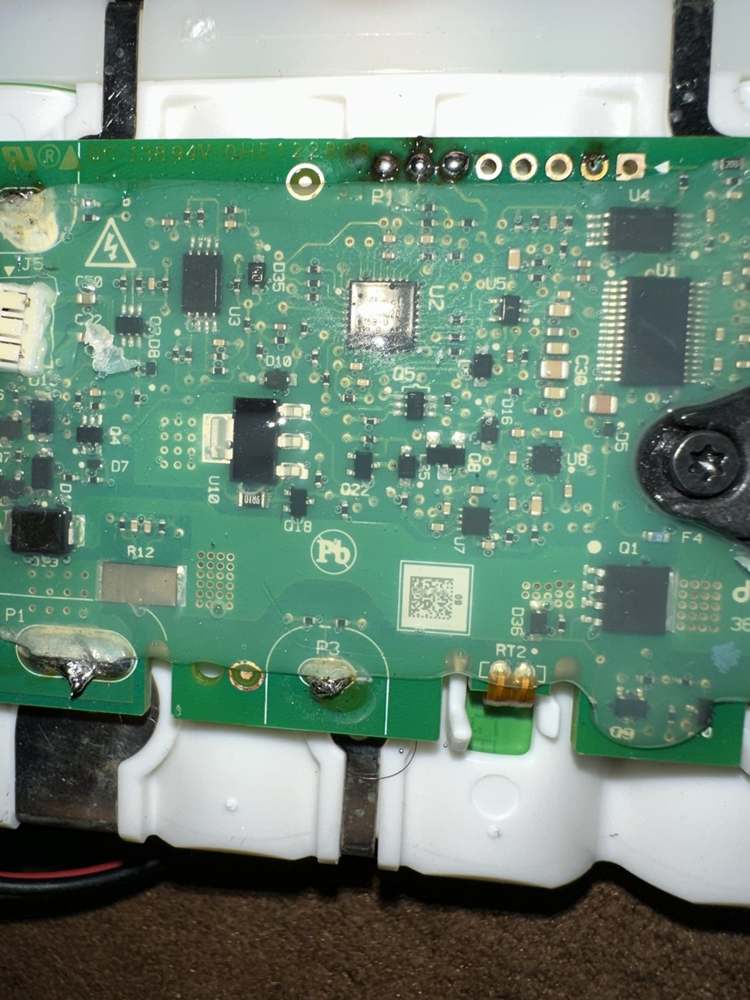
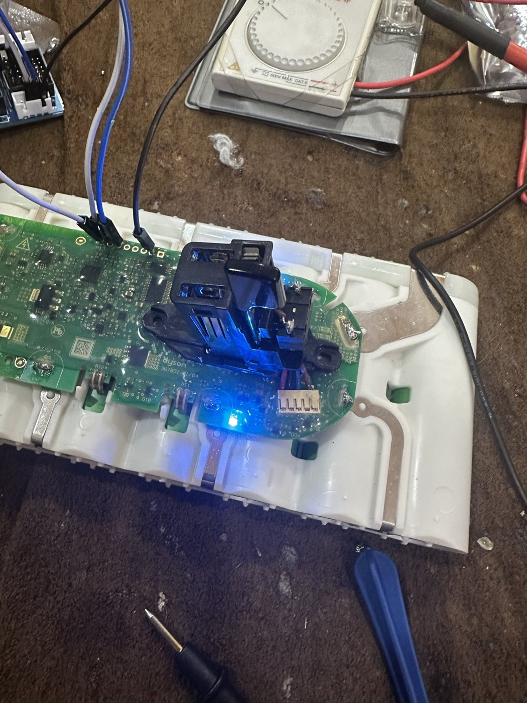
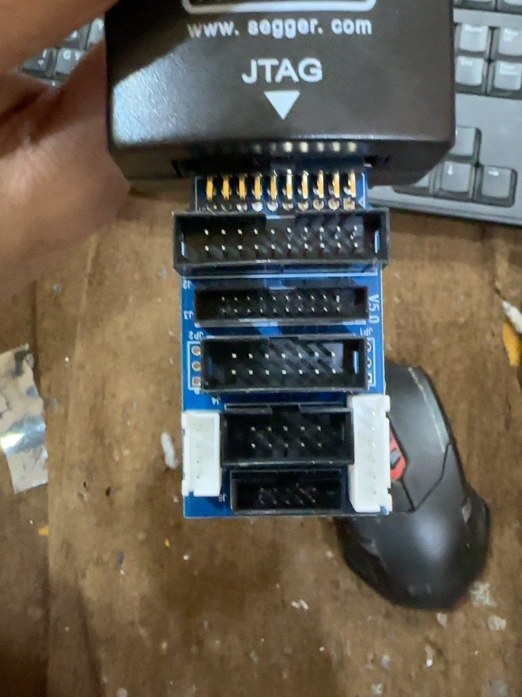
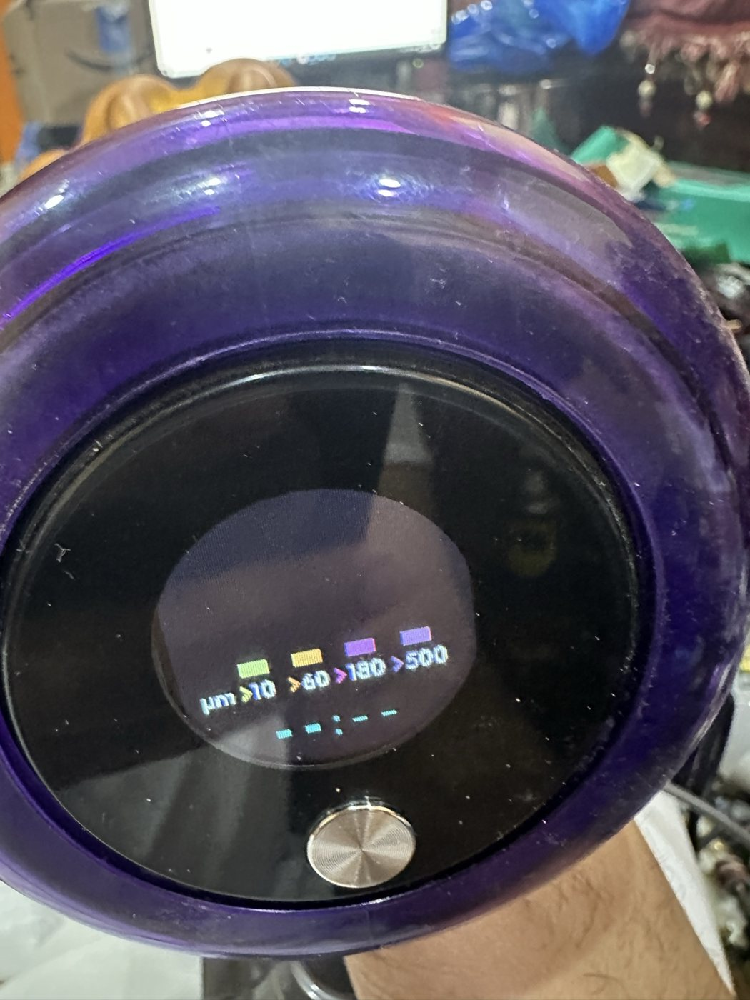
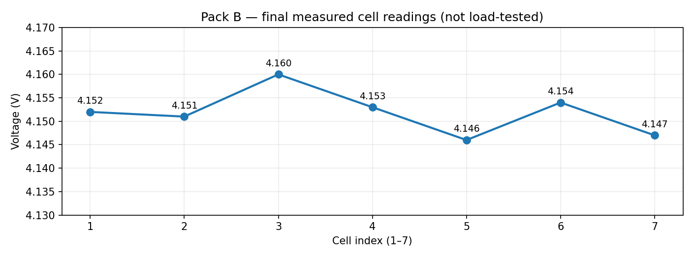

# Dyson V15 SV22 — Battery BMS Recovery: A Saudi Independent Repair Case Study 🇸🇦

> **Status: partial, documented recovery — not a complete, independently validated battery repair.**
> **This is a case study, not an executable end-to-end flashing procedure.**
> One **decisive standalone-startup repair step** is **intentionally withheld**. The preceding investigation and service history are documented below. The withheld step can be discussed directly with the author for legitimate repair/research collaborations.

## Why I documented this

I investigated two separate Dyson V15 / SV22 lithium-ion battery packs. One pack was used to establish a working firmware development and SWD debugging workflow. The second exhibited intermittent voltage-sensing faults, a persistent fault state, and a failure to respond normally when operated without a debugger.

The results were obtained experimentally by measuring actual circuit voltages, inspecting MCU RAM and peripheral registers, reading the battery AFE through firmware diagnostics, and comparing readings before and after physical repairs.

**Important:** This work builds on existing community firmware and documentation; I do not claim to have invented the entire firmware, to be the first worldwide to perform the procedure, or to have completed all functional validation.

## Tested environment

| Item | Observed setup |
|---|---|
| Battery | Dyson V15 family, SV22, 7 Li-ion cells in series |
| Main MCU | Microchip ATSAMD20E15A (ARM Cortex-M0+) |
| AFE | Texas Instruments BQ76930 family |
| Debugger | SEGGER-compatible J-Link, SWD |
| SWD rate | 100 kHz |
| Build host | Windows 10/11-class PowerShell environment; Visual Studio Developer PowerShell |
| Build system | ARM GNU Toolchain 14.2.x, CMake, Ninja |
| Base firmware | [`vladislav1983/V11_Dyson_BMS`](https://github.com/vladislav1983/V11_Dyson_BMS), itself derived from [`davidmpye/V10_Dyson_BMS`](https://github.com/davidmpye/V10_Dyson_BMS) |

Board and hardware revisions matter. Do not assume that two batteries bearing the same external model label share identical PCB pin assignments or operating behavior.

## Chronological investigation — public overview

### Phase 1 — Establish a debugger and firmware workflow (Pack A)

1. Identified the ATSAMD20-family MCU and the BQ76930-class front end.
2. Established a stable SWD connection at a reduced clock rate.
3. Encountered the MCU security setting; chose to replace the factory firmware on the experimental board. **Factory firmware removal is irreversible when no backup is available.**
4. Compiled community-derived firmware locally, verified the programmed image, and successfully restarted the processor.
5. Read real-time state and cell measurements using RAM symbol locations from the corresponding ELF build.
6. Observed pack interaction with the vacuum and LED indications on the first experimental pack; this was not a measured full-cycle qualification.

### Phase 2 — Diagnose unexpected behavior (Pack B)

1. Programmed a separate SV22 pack, then observed fault indications and charge-current interruption.
2. Read an MCU-reported error/state pair of `0B 07`. In the tested source build, this corresponded to a cell-imbalance fault in the fault state.
3. Compared software voltage measurements with independent digital-multimeter measurements. The two initially disagreed dramatically on the upper cells.
4. Built a *passive* diagnostic firmware variant to snapshot the AFE's voltage measurement registers and calibration values. This revealed a measurement-path issue, not proof that several cells were simultaneously defective.
5. Found an unexpectedly large voltage drop across the component marked **F1**: roughly **25 V** at one end and **29 V** at the other, measured relative to pack negative, or around **3.89 V directly across it**. Replaced the defective fuse/connection rather than assuming the cells were damaged.
6. Repeated voltage measurements. After repair, all seven channels agreed closely and the measured spread dropped to approximately **14–15 mV**.
7. Investigated a persistent nonvolatile fault indication, corrected its underlying electrical cause, and confirmed that the reported fault was subsequently cleared. Full service implementation details are not published.
8. Verified that the standalone button/LED behavior differed from the debugger-attached behavior.
9. Isolated an additional board-level standalone-startup fault. A reversible bench intervention restored local button/LED response without the debugger. **The decisive repair method and underlying measurements are intentionally withheld.**

### Phase 3 — What the measurements actually proved

| Observation | Confirmed evidence | Meaning / limit |
|---|---|---|
| SWD programming succeeded | J-Link reported `Program & Verify: O.K.` | The image was written and verified; this alone does not prove correct battery operation. |
| Fault latched | `0B 07` | Fault logic in the tested software identified cell imbalance. |
| False or path-dependent cell data | Example: one channel around 0.9 V while the physical cell measured >3 V | Further electrical debugging was needed; the software reading was not a reliable cell-voltage measurement in that state. |
| Measurement recovered | Example snapshot: `4.152, 4.151, 4.160, 4.153, 4.146, 4.154, 4.147 V` | 29.063 V total, 14 mV spread. |
| Fault state cleared | `00 01` in the tested build | The controller reported no active error and IDLE at the time of inspection. |
| Button/LED response restored in a bench test | Verified without the programmer after a controlled hardware change | A useful diagnostic success; long-term, high-current operation has **not** been established in this report. |

## Photographic evidence (user-supplied)

These images are from the investigator's bench documentation. They are **context photographs**, not proof that both packs passed all load and charging tests. Original EXIF metadata has been removed from the exported copies.

| Battery PCB | SWD bench setup |
|:--:|:--:|
|  |  |
| **PCB inspection:** component identification and signal tracing | **Bench response:** LED illuminated with debugger setup visible |

| Programming equipment | Vacuum display |
|:--:|:--:|
|  |  |
| **Hardware:** J-Link adapter used during experiments | **Display observation:** an illuminated Dyson display; this photo by itself does not establish Pack B's full-load operation |

Additional unannotated PCB image: [PCB secondary view](pcb-detail.jpg).

Measured cell voltages (Pack B, final read-only snapshot):

Data behind the plot: [`cell-readings.csv`](cell-readings.csv) and [`measurement-notes.md`](measurement-notes.md).

## The intentionally withheld portion

This public report **does not include the decisive standalone-startup intervention**: the precise diagnosis, component/value, connection points, and long-term rework details. Full annotated source, private notes, and firmware binaries are also not distributed; this prevents unintended distribution of GPL-derived build artifacts and private materials, rather than implying those files are the secret step.

**Contact the author for collaboration on this non-public step.** The omission is deliberate and disclosed. It is **not** a technological lock: another researcher may independently discover an equivalent repair. Nothing here should be interpreted as an instruction to erase an otherwise functional BMS and then attempt an incomplete procedure.

## Debugging workflow — reproducibility notes

The investigator used SWD diagnostics, a build-specific ELF symbol map, and read-only inspection of controller state and per-cell readings. MCU RAM symbol addresses changed between firmware builds; blindly reusing an address from another build caused misleading zeros. Exact programming and private service scripts are intentionally not packaged here. Do not erase a working BMS based on this report.

## What is *not* claimed

- No verified multi-cycle, real-world charge/discharge qualification is provided for Pack B.
- No guarantee is made that the same board repair applies to other SV22 PCB revisions.
- No claim of a unique, first-in-the-world technique is made.
- No binary firmware or full modified source is distributed here.

## Acknowledgments and software rights

The firmware work was built on the work of the community authors of [`V11_Dyson_BMS`](https://github.com/vladislav1983/V11_Dyson_BMS) and [`V10_Dyson_BMS`](https://github.com/davidmpye/V10_Dyson_BMS). The former states **GPL-3.0-or-later**. If modified GPL-covered firmware is distributed in source or binary form, applicable license obligations must be followed. This publication contains original descriptive case-study text only and links to upstream projects.

## Safety and research note

High-energy lithium-ion packs can cause fire or injury when opened, shorted, improperly charged, or subjected to unvalidated firmware. This article intentionally avoids offering a turnkey flashing or bypass procedure. Repair outcomes described here are observations from specific test packs, not general guarantees.

---

*Independent repair work from Saudi Arabia 🇸🇦 — measured, documented, and open to technical dialogue. For inquiries, please open a GitHub Issue in this repository.*
