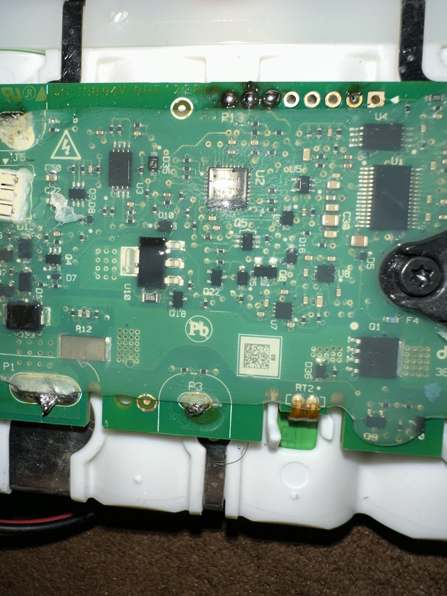
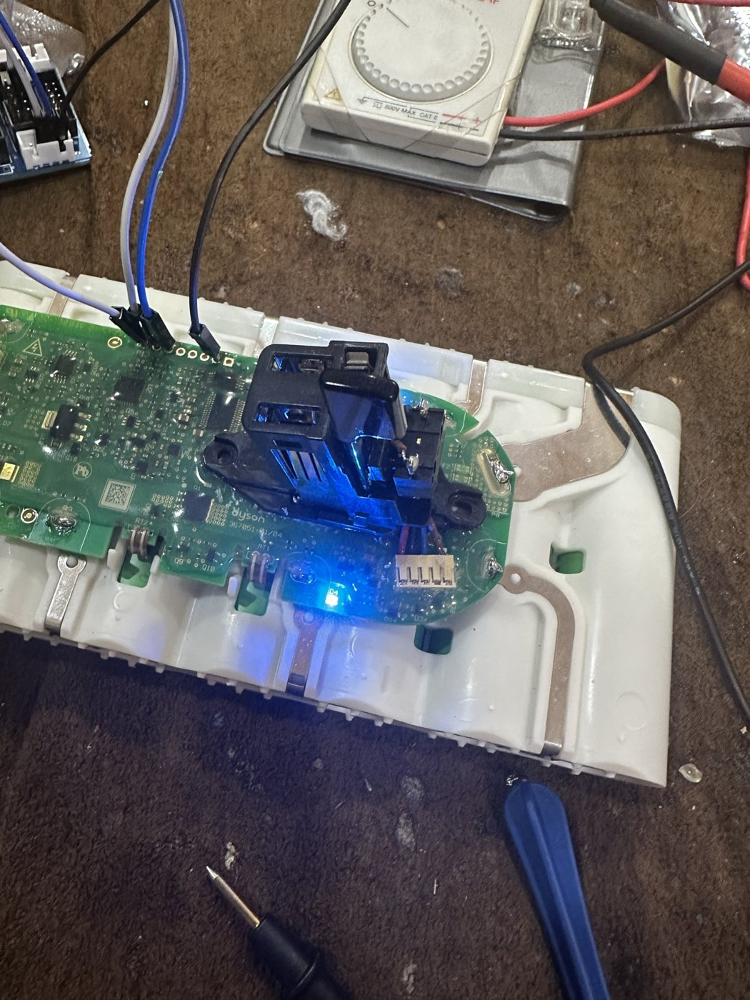
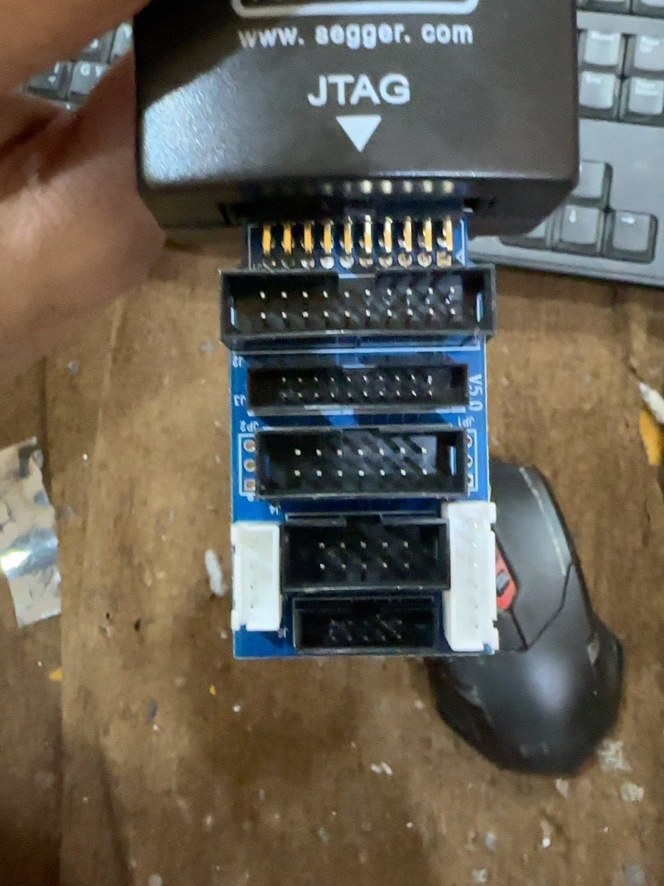
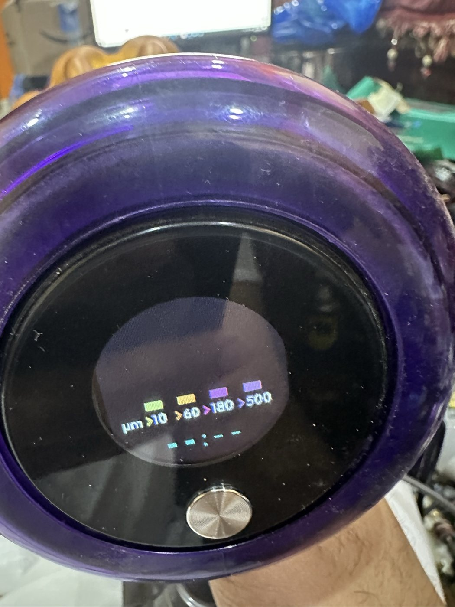
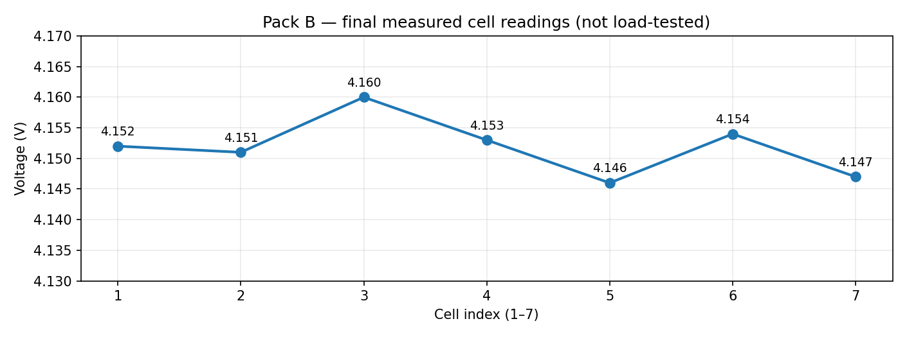

# تجربة  في تشخيص وإصلاح BMS بطارية Dyson V15 SV22 🇸🇦

> **الحالة: نجاحات تشخيصية واستعادة استجابة جزئية موثقة؛ ليست شهادة بأن البطارية اجتازت جميع اختبارات التشغيل.**
> **هذا تقرير تجربة، وليس دليل تفليش كاملًا قابلًا للتنفيذ من البداية للنهاية.**
> **الخطوة الحاسمة الأخيرة فقط** الخاصة باستعادة الاستجابة بدون المبرمجة محفوظة لدى صاحب التجربة، ويمكن مناقشتها بالتواصل المباشر.

## ملخص التجربة

اشتغلت على بطاريتين منفصلتين من عائلة Dyson V15 / SV22. في الأولى أسست طريقة الاتصال بمعالج `ATSAMD20E15A` عن طريق `J-Link / SWD`، وبنيت سوفتوير مبنيًا على مشروع مجتمع مفتوح المصدر، ونجحت ببرمجته وتشغيله وتشخيص حالة البطارية. أما الثانية فواجهت فيها قراءات خلايا خاطئة وقفلًا برمجيًا وتوقفًا عن الاستجابة عند فصل المبرمجة.

بدل الاكتفاء بإعادة التفليش، قارنت بيانات `BMS` بقراءات الأفوميتر، وقرأت سجلات شريحة `BQ76930`، وتتّبعت السبب على مستوى الدائرة. وبعد معالجة انقطاع في أحد المسارات، رجعت القراءات متقاربة جدًا، ثم نجحت في استعادة حالة الاستعداد ومعالجة ظاهرة مرتبطة بتشغيل المعالج.

## المعدات والمعلومات المؤكدة

- الموديل: Dyson V15 SV22، بطارية سبع خلايا `7S`.
- المعالج: `ATSAMD20E15A`، وشريحة قياس الخلايا من عائلة `BQ76930`.
- البرمجة: `J-Link` عبر `SWD` بسرعة `100 kHz`.
- بيئة البناء: Windows، و`PowerShell`، و`ARM GNU Toolchain`، و`CMake` و`Ninja`.
- أساس السوفتوير: [V11_Dyson_BMS](https://github.com/vladislav1983/V11_Dyson_BMS) والمشروع السابق [V10_Dyson_BMS](https://github.com/davidmpye/V10_Dyson_BMS).

## التسلسل العام

1. فحصت مكونات البورد وحددت واجهة البرمجة.
2. تجاوزت مشكلة الاتصال بالمعالج واستخدمت معدل اتصال منخفضًا.
3. بنيت نسخة سوفتوير تجريبية وحمّلتها للمعالج، مع ظهور تأكيد `O.K.` في البرمجة والتحقق.
4. قرأت متغيرات حالة النظام وجهود الخلايا من RAM باستخدام ملف ELF المطابق للنسخة.
5. عند ظهور الخطأ `0B 07` في البطارية الثانية، قارنت جهود الخلايا بالأفوميتر.
6. استخدمت تشخيص سجلات `BQ76930` الخام، وظهر أن مشكلة القياس ليست دليلًا على تلف الخلايا.
7. اكتشفت هبوط جهد نحو **3.89V** بين طرفَي العنصر `F1` (مع قراءة تقريبية **25V** و**29V** من `B−`)، ثم استبدلت الفيوز المتضرر، فرجعت قراءات الخلايا تتقارب.
8. رجعت القراءات السبع إلى نحو `4.15V` للخلية، بفارق **14mV** فقط بين أعلى وأقل خلية.
9. عالجت حالة خطأ محفوظة بعد إصلاح الخلل الكهربائي، وتأكدت من رجوع حالة BMS إلى `00 01`. طريقة الخدمة التفصيلية غير منشورة.
10. تابعت مشكلة استجابة البطارية عند فصل المبرمجة، وحددت عطلًا إضافيًا على مستوى الدائرة، ثم استعدت استجابة الزر واللمبات في اختبار على الطاولة. **قياسات هذا العطل وطريقة علاجه الحاسمة محفوظة عند صاحب التجربة.**

## نتائج موثقة من سجلات التجربة

| القراءة | النتيجة |
|---|---|
| عند القفل | `bms_error=0B`, `bms_state=07` |
| بعد الإصلاح واستعادة القراءة | `4.152 / 4.151 / 4.160 / 4.153 / 4.146 / 4.154 / 4.147 V` |
| إجمالي الجهد | `29.063V` |
| فرق الخلايا | `14mV` |
| الحالة بعد المعالجة | `bms_error=00`, `bms_state=01 (IDLE)` |
| اختبار الزر | ظهرت استجابة لللمبات بدون J-Link بعد تدخل تشخيصي قابل للعكس |

**تنبيه للدقة:** هذه النتائج لا تثبت اكتمال اختبار التشغيل تحت الحمل أو دورات الشحن المتكررة.

## صور ونتائج التجربة

**ملاحظة:** الصور تثبت وجود التجارب والأجهزة واستجابة بعض المؤشرات، لكنها ليست دليلًا مستقلًا على اكتمال اختبارات البطارية الثانية تحت الحمل.

ملف القياسات: [`cell-readings.csv`](cell-readings.csv)، والشرح: [`measurement-notes.md`](measurement-notes.md).

## حقوق ومراجع

التجربة بنت على مشروع مفتوح المصدر بترخيص [GPL-3.0 أو أحدث](https://github.com/vladislav1983/V11_Dyson_BMS). من المهم احترام حقوق مؤلفي السوفتوير الأصلي عند توزيع أي كود أو ملف Firmware معدل. 
